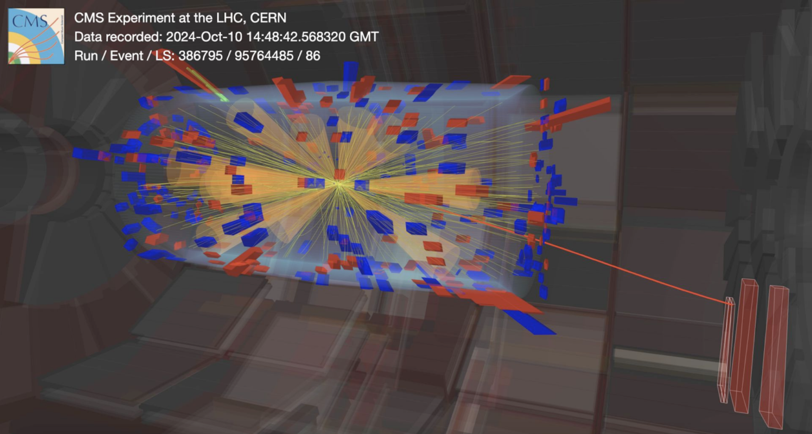

## Hackathon Project: Anomaly Detection at the CMS Level-1 Trigger

High-energy colliders, like the Large Hadron Collider, accelerate particles and smash them together, recreating early-universe conditions to search for new phenomena. These collisions generate more data than can be stored, so the CMS Level-1 Trigger (L1T) system must decide what to keep within microseconds, retaining some events and discarding others permanently. Consequently, there is a danger of discarding new physics: **if the next discovery looks unlike anything we have predicted, how can we design a trigger that knows to keep it?**



*Figure 1: A proton-proton collision recorded by CMS on 10 October 2024 (run 386795, event 95764485). The yellow lines are the tracks of charged particles, the red and blue towers are energy deposits in the electromagnetic and hadronic calorimeters, and the orange cones are jets. The red line leaving the detector on the right is a muon, passing through the muon chambers (red boxes). This is an **anomalous** event triggered by the CICADA algorithm.*

Since the discovery of the Higgs boson in 2012, there have been no clear signs of new fundamental particles. CMS has searched for many specific new-physics scenarios, but what if new physics is something nobody has thought of yet? To get the most out of the LHC, we need to explore every way of finding it, including ways that don't depend on knowing in advance what it looks like.

### The CMS trigger system

Proton bunches collide in CMS every 25 ns, 40 million times per second. Far too much data to store, so a two-stage *trigger* selects the events to keep:

| Stage | Input rate | Output rate | What it does |
|---|---|---|---|
| Level-1 Trigger (L1T) | 40 MHz | 100 kHz | Custom electronics (FPGAs). Keeps 0.25% of events, and must decide within 3.8 μs. |
| High Level Trigger (HLT) | 100 kHz | 1 kHz | A computer farm. Keeps 1% of what L1 accepted, for analysis. |

Both stages run algorithms designed to pick out interesting physics: events with energetic muons, many jets, large missing energy, and so on. An event that the trigger rejects is lost forever. **If the existing trigger misses new physics, that data is gone**, which motivates running anomaly detection directly at the L1T.


*Figure 2: The path of an event through CMS. The detector (left) measures muons, photons, electrons, jets and the missing transverse momentum p<sub>T</sub><sup>miss</sup>. The Level-1 Trigger reduces 40 million events per second to about 110 thousand, and the High-Level Trigger to about a thousand, which are saved for data analysis. CMS already runs two anomaly detection algorithms in the Level-1 Trigger: CICADA in the calorimeter trigger, which looks at calorimeter energy deposits, and AXOL1TL in the global trigger, which looks at reconstructed objects like the ones in this hackathon's dataset. From CMS Collaboration, [CMS-PAS-MLG-25-001](https://cds.cern.ch/record/2967864), "Unsupervised anomaly detection for real-time data acquisition in the CMS experiment at the Large Hadron Collider" (2026).*

### Anomaly detection with autoencoders

One way to address this question is by designing a trigger that is an anomaly detection algorithm. Anomaly detection algorithms are typically designed around an autoencoder, which is a machine learning model that compresses (*encodes*) the input down to a low-dimensional *latent space* and then decompresses (*decodes*) the latent space representation to match the input as closely as possible.

For the CMS L1T use case, the model is trained on what we call "Zero Bias" data, which is a random selection of collision data containing no preferential selection towards any physics. Events we actually would want to trigger on are so rare in the Zero Bias dataset that it is essentially a background dataset without any need for simulation. The autoencoder learns to reconstruct Zero Bias data with minimal error, but as it has not been exposed to signal events, it reconstructs signal events poorly. The difference between the input and the output can therefore be used as an "anomaly score". To use this in the context of the trigger, which makes a "keep or discard" decision, we then set an anomaly score threshold and keep every event which passes the threshold.

Training is **unsupervised**: the model never sees a labelled signal event, so it isn't tied to any particular new-physics model.


*Figure 3: An autoencoder compresses (encodes) an event into a small latent space, then reconstructs (decodes) it. Top: a typical LHC event, like the ones it was trained on, is reconstructed well. Bottom: an event with new physics (beyond the Standard Model, BSM) is unlike anything the autoencoder has seen, and is reconstructed poorly. The difference between the input and the reconstruction is the anomaly score.*

### Level-1 Trigger requirements

When designing a trigger algorithm, we can't simply train a model and optimize for performance only. These algorithms run "online" during detector operation: a new collision arrives every 25 ns, and the whole Level-1 decision must be made within 3.8 μs. This ultra-low latency is enabled by running the algorithms on **field-programmable gate arrays (FPGAs)**: chips whose circuits can be rewired, so that the neural network runs directly in hardware. There are no CPUs or GPUs in the Level-1 Trigger. The algorithms also must fit onto the FPGAs, often sharing one chip with other algorithms.

The diagram below compares the streaming data rate and latency requirements of the L1T (both ATLAS and CMS experiments) to those of other HEP experiments and non-HEP applications. The data rate is similar to Netflix's, but the decisions are needed tens of millions of times faster: the LHC Level-1 triggers are at the frontier of low-latency computing, and a test bed for fast machine learning.


*Figure 4: Streaming data rate against latency requirement for scientific experiments and commercial applications in 2026; the size of each bubble is the annual data volume. The LHC Level-1 Triggers (and DUNE) handle about as much data per second as Netflix, but must respond in microseconds instead of minutes, which puts them in the hardest corner of the plot. Updated from the A3D3 Institute ([a3d3.ai](https://a3d3.ai)).*

### The dataset: real CMS Level-1 Trigger data

[CMS L1T anomaly detection dataset](https://huggingface.co/datasets/CERN/anomaly_detection_cmsl1t)
([Zenodo DOI 10.5281/zenodo.21787779](https://doi.org/10.5281/zenodo.21787779)): CMS open data from 2025, released under CC0 (free to use). It contains three kinds of samples:

- **Zero Bias collision data**: the normal events we train on. Collisions recorded at random in 2025, with no physics selection: about 10 million events in one run alone.
- **Simulated background** (SingleNeutrino): a simulation of zero bias. What are the inherent differences between data and simulation?
- **Simulated new-physics signals**, never seen in training: 20 samples, including Higgs → ττ, W → 3μ, supersymmetry, triple Higgs production and dark showers (SUEP). See `dataset.SIGNALS` for the full list.

Each event holds the objects the Level-1 Trigger reconstructs: up to 8 muons, 12 jets, 12 e/γ (electrons and photons) and 12 taus, plus energy sums (ET, HT, MET, MHT, ...). Each object is described by its transverse energy Eₜ, pseudorapidity η and azimuthal angle φ. Events with fewer objects are padded with zeros, which gives a small, fixed-size input that fits an FPGA-sized model. See the dataset card for details.

The config files in `config/` define three experiments:
- `baseline`: train on one run of real zero-bias collision data
- `combined`: train on both zero-bias runs
- `simulation`: train on *simulated* zero-bias events (SingleNeutrino), evaluate on real data

All three evaluate on the same zero-bias test data and the same set of simulated signals.

<!-- TODO(organisers): the research question. For example:
The goal is to train a model that flags signal events as anomalous while keeping only a small fraction
of normal events. In particular, we want to compare:
- your own models against the baseline dense autoencoder in `models/`
- a model trained on real data vs. one trained on simulation
The question is: ...
-->

### From a model to an FPGA

Getting a neural network into the Level-1 Trigger takes several steps:

1. **Model**: train a model with PyTorch.
2. **Quantized model**: train a model with quantized layers (Brevitas), so that it works with the few bits an FPGA can afford (see [Quantization](#quantization) below).
3. **hls4ml**: translate the trained network into C++ for *high-level synthesis* (HLS).
4. **C++/HLS project**: an HLS tool turns the C++ into hardware code (Verilog/VHDL). hls4ml and this step are really one step: hls4ml writes the HLS project, including the instructions (*pragmas*) that tell the HLS tool how to build the circuit.
5. **Hardware**: deploy on an AMD Virtex FPGA chip, as used in the CMS Level-1 Trigger.

In this hackathon we go as far as step 3.

### Quantization

**Why.** On a CPU or GPU, a network computes with 32-bit floating-point numbers. On an FPGA, every multiplication is built out of the chip's logic, and the size of a multiplier grows with the number of bits of its inputs: multiplying two 16-bit numbers needs about 16 × 16 = 256 bit operations, two 4-bit numbers only 4 × 4 = 16, which is 16 times cheaper. Fewer bits also make the circuit faster. So FPGA networks use as few bits as they can get away with, and floating point is far too expensive.

**Fixed-point numbers.** Instead of floats, the FPGA uses fixed-point numbers: `ap_fixed<W, I>` has `W` bits in total, `I` of them for the integer part (including the sign) and `W - I` for the fraction. For example, `ap_fixed<8, 3>` covers -4 to 3.97 in steps of 1/32. Two things can go wrong with too few bits:
- too few **integer** bits: large values *overflow* (they wrap around or saturate), usually a disaster;
- too few **fractional** bits: values are *rounded* coarsely, so the model's output changes a little.

**Post-training quantization (PTQ).** The simplest approach: train in floating point, then round everything to fixed point when converting the model. This works with many bits, but with few bits the rounded model is effectively a *different* model from the one you trained, and nothing in training prepared it for that. `convert_hls4ml.ipynb` shows this: convert a float model with fewer and fewer bits and watch the AUC jump around.

**Quantization-aware training (QAT).** Instead, round the weights and activations to the target number of bits *during training*, so that the model learns to work with them. In the forward pass, every quantized layer rounds its values, exactly as the FPGA will. Rounding has a gradient of zero almost everywhere, which would stop training, so in the backward pass the rounding is treated as if it weren't there (the *straight-through estimator*). The result is a model whose fixed-point version behaves the same as the one you trained, with far fewer bits than PTQ needs.

**Brevitas.** We do QAT with [Brevitas](https://github.com/Xilinx/brevitas), a PyTorch library from AMD/Xilinx. Turning a model into a quantized one mostly means swapping layers, for which `models/autoencoder.py` has three helpers:

| PyTorch layer | Quantized replacement | What it quantizes |
|---|---|---|
| (none) | `quant_input(bits)` | the values going into the next layer, e.g. the model inputs |
| `nn.Linear(n_in, n_out)` | `quant_dense(n_in, n_out, bits)` | the weights (and the bias) |
| `nn.ReLU()` | `quant_relu(bits)` | the output of the activation |

`dense-qae` in `models/autoencoder.py` is the quantized version of the baseline `dense-ae`, with 6-bit weights and activations. A Brevitas quantizer stores a value as an integer times a *scale*; the helpers use power-of-two scales (so the value is exactly a fixed-point number) and quantize the biases, which is what hls4ml needs to convert the model. Use them rather than `brevitas.nn` directly.

**Pruning.** Weights that are exactly zero cost nothing on the FPGA: hls4ml leaves the multiplication out. Setting small weights to zero (*pruning*) is another way to make a model cheaper.

### Hackathon goals

There are three levels. Each builds on the previous one.

**Level 1 (PyTorch).** Train an autoencoder anomaly detection model on Zero Bias data which has a high AUC for a variety of benchmark signal models. In [`train.ipynb`](train.ipynb), choose the input objects and features, design a model, train it, and compare it with the baseline in [`evaluate.ipynb`](evaluate.ipynb). Can you beat `dense-ae`? Can you match it with a much smaller model?

**Level 2 (Brevitas).** Train a quantized autoencoder by replacing the PyTorch layers with Brevitas layers (see [Quantization](#quantization)). Start from `dense-qae`: how few bits can you use before the performance drops? Is it better to have a big model with few bits, or a small model with more bits?

**Level 3 (hls4ml).** Convert your model into C++ with hls4ml in [`convert_hls4ml.ipynb`](convert_hls4ml.ipynb), and verify that the converted model gives the same answers as the PyTorch model. Compare a float model converted with few bits with a quantization-aware trained one. In the end, what counts is the firmware: find the best model on the Pareto front of the *firmware* trials, and check that its trigger threshold still keeps the rate it should.

The next step would be synthesis into a hardware description language (Verilog/VHDL), but we will stop here: the last section of `convert_hls4ml.ipynb` explains what it would involve.

### How models are evaluated

A trigger model has to be good at finding new physics **and** cheap enough to run on the FPGA. We measure both: **maximize the AUC while minimizing the BOPs**.

#### Physics performance: benchmark signals and AUC

The model is trained without ever seeing a signal, because the whole point is to catch new physics we haven't predicted. But to measure how well it does, we need *some* examples of new physics. So we test it on **benchmark signals**: simulated physics processes that the model never sees during training, which stand in for the unknown. They are chosen to look very different from each other, so that a good score means the model flags many kinds of unusual events, not just one:

| Benchmark signal | What it is | What it looks like in the trigger |
|---|---|---|
| `GluGluHto2Tau_Par-MH-125` | a Higgs boson (125 GeV) decaying to two τ leptons | taus, moderate energy |
| `WtoTauto3Mu` | a W boson decaying to a τ, which decays to three muons (so rare in the Standard Model that it has never been seen) | several soft muons |
| `SUSYGluGluToBBHTo2B_Par-M-1200` | a heavy supersymmetric Higgs boson (1.2 TeV) produced with b quarks, decaying to two b quarks | very energetic jets |
| `haa-4b-ma15` | a Higgs boson decaying to two new light particles (15 GeV), each decaying to two b quarks | several soft jets: hard to tell from normal events |

Because the benchmarks only stand in for the unknown, don't tune your model to one of them: a model that is excellent on one signal and blind to the others is not a good anomaly detector. Look at all of them, and at the worst one as well as the average.

For each benchmark signal, we compute the **AUC**, the area under the ROC curve. Sweep the anomaly-score threshold from high to low: at every threshold, a fraction of the zero-bias events pass (the *background acceptance*) and a fraction of the signal events pass (the *signal efficiency*). The ROC curve traces signal efficiency against background acceptance. An AUC of 1.0 means perfect separation; 0.5 means random guessing. Higher is better.

`evaluate.ipynb` also reports the **signal efficiency at a fixed background acceptance** (`ACCEPTANCE`, 10⁻³ by default). This is how a real trigger is judged: the bandwidth decides what fraction of normal events the trigger may keep, and within that budget it should catch as much signal as possible.

<!-- TODO(organisers): choose the operating point (ACCEPTANCE) for the hackathon. -->

#### Hardware cost: BOPs and layers

Without building the firmware, `utils.model_cost` estimates how big and slow a model would be on the FPGA:

- **BOPs (bit operations)**: an estimate of how much FPGA logic the model needs. Multiplying a `b_a`-bit input by a `b_w`-bit weight costs about `b_a × b_w` bit operations, summed over every multiplication in the model (a layer with `n` inputs and `m` outputs does `n × m` of them, plus a small cost for adding up the results). Lower is better. On the FPGA, hls4ml gives every multiplication its own piece of hardware so that they all happen at once, which is why the area grows with both the number of multiplications and their bit width. Lower the BOPs with fewer inputs, smaller layers, fewer bits (quantization) and zero weights (pruning). Layers that aren't quantized count as 16 bits, the default precision of hls4ml.
- **Number of layers**: every layer an event goes through adds a few clock cycles, so this is a rough measure of the latency.
- **Number of parameters**: the memory the weights need. On its own this can be misleading: a small layer that is applied to every object separately has few parameters but many multiplications.

These are estimates: the real resource usage and latency come from synthesis (see [From a model to an FPGA](#from-a-model-to-an-fpga)), which takes minutes to hours per model and needs AMD's HLS tools. BOPs are the standard estimate for comparing quantized networks ([Hawks et al. 2021](https://arxiv.org/abs/2102.11289)), and are good enough to tell a cheap model from an expensive one.

#### Putting them together

`evaluate.ipynb` saves every model you evaluate as a *trial* and plots all trials, performance against BOPs. The dashed line in that plot is the *Pareto front*: the models that no other model beats at a lower cost. A good model pushes the front up (better physics) and to the left (cheaper hardware).

### Getting started

1. Clone the repository in JupyterLab and open [`setup.ipynb`](setup.ipynb). On BinderHub it installs the few
   libraries missing from the image; elsewhere it creates a virtual environment and registers it as a Jupyter kernel.
   It then checks the GPU and downloads the data.
2. [`explore_data.ipynb`](explore_data.ipynb): a tour of the dataset.
3. [`train.ipynb`](train.ipynb): choose the input objects and features, choose or write a model, and train it.
   Run it as it is to train the baseline `dense-ae`; set `model_type = "dense-qae"` to train the quantized one.
4. [`evaluate.ipynb`](evaluate.ipynb): compare models, save each one as a trial, and plot all trials
   (performance vs. cost).
5. [`convert_hls4ml.ipynb`](convert_hls4ml.ipynb): convert a model to FPGA firmware with hls4ml, check how
   fixed-point arithmetic changes its output, and convert a quantization-aware trained (Brevitas) model.

The TODOs in the notebooks mark the places to make choices or fill in code. Add your own models in the notebook or in
`models/autoencoder.py` with the `@register(...)` decorator.

### Repository layout

| File | What it does |
|---|---|
| `config/*.yml` | data configs: which samples to train / validate / test on, and the input scaling |
| `dataset.py` | download the data and read it into arrays (awkward / numpy) |
| `dataloader.py` | turn a data config and an input choice (layout, features) into arrays ready for PyTorch |
| `models/` | model definitions and quantized layers (`autoencoder.py`), and the model registry |
| `utils.py` | training, metrics, model cost (BOPs), trials, and hls4ml / QONNX helpers |
| `plotting.py` | plots |

### Citation

```bibtex
@dataset{cms_l1t_anomaly_2026,
  author    = {{CMS Collaboration}},
  title     = {Trigger Anomaly Detection for New Physics at the Large Hadron Collider},
  year      = {2026},
  publisher = {Zenodo},
  version   = {1.0},
  doi       = {10.5281/zenodo.21787779},
  url       = {https://doi.org/10.5281/zenodo.21787779}
}
```
